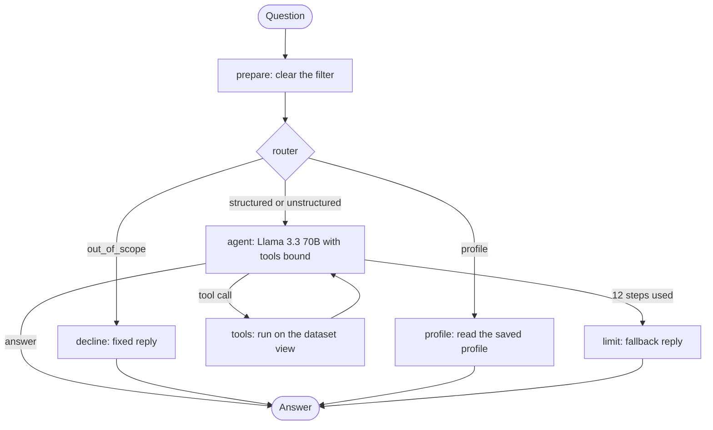

# Customer Support Data Analyst Agent

A LangGraph agent that answers plain-English questions about the [Bitext customer support dataset](https://huggingface.co/datasets/bitext/Bitext-customer-support-llm-chatbot-training-dataset): 26,872 customer messages with agent replies, tagged with 11 categories and 27 intents. It is for an analyst who wants counts, examples, intent breakdowns or summaries without writing pandas: the agent works each answer out with tool calls over the data and shows every step, in a terminal or a Streamlit chat. The same tools are also served to any MCP client.

## What it shows

- **Agent loop and routing:** a LangGraph `StateGraph` where an LLM router labels each question (structured, unstructured, out of scope, profile) before any tool runs, then a hand-built ReAct loop of model and tool calls, capped at 12 steps.
- **Tool calling:** eight LangChain tools over a pandas view of the dataset (list, filter, count, sample, intent counts), with Pydantic input schemas; filters chain within a turn.
- **Memory:** per-session chat history in SQLite checkpoints that survive restarts, plus a per-user profile the LLM distills after each in-scope turn and keeps in its own file.
- **MCP server:** FastMCP over stdio exposes seven of the tools to any MCP client (Claude Desktop, Cursor, Claude Code).
- **UI:** a Streamlit chat and a CLI, both showing the router's decision, each tool call and its result next to the answer.
- **Query recommender:** suggests a next question from the conversation and profile, and runs it only after you say yes.
- **Tests:** an offline regression test for cross-turn filter state, plus smoke scripts for the tools, routing, memory and the MCP server.

## How a question flows



The graph is in `src/graph.py`. Around it, `src/agent_runner.py` handles the query recommender before a turn and updates the user profile after it; the CLI and the Streamlit app both go through it.

| Tool | What it does |
|------|--------------|
| `list_categories` | All category names |
| `list_intents` | Intent names, optionally for one category |
| `filter_by_category` | Narrow the working view to a category |
| `filter_by_intent` | Narrow the working view to an intent |
| `reset_filters` | Back to the full dataset |
| `count_rows` | Rows in the current view |
| `sample_examples` | Random instruction/response pairs (up to 20) |
| `intent_distribution` | Intent counts in the current view |

## Examples

**"How many refund requests did we get?"** The router labels it `structured`. The system prompt says never to guess numbers and to filter before counting, so the expected chain is `filter_by_intent("get_refund")`, then `count_rows()`, and the answer carries the count. Over MCP the same two calls return 997 (`scripts/test_mcp.py`).

**"Who is the president of France?"** The router labels it `out_of_scope` (`scripts/smoke_test.py` checks this) and no tool runs. The reply is fixed in `src/graph.py`:

> I can only answer questions about the Bitext customer support dataset (categories, intents, counts, examples, and summaries of that data). I can't help with that question.

Others to try: *What categories exist in the dataset?* *Show me 5 examples of the SHIPPING category.* *Summarize how agents respond to complaint intents.* *What is the distribution of intents in the ACCOUNT category?*

## Run it

Prerequisites:

- Python 3.10 or newer (the code uses `X | None` type syntax). Check with `python3 --version`.
- A Nebius Token Factory API key, created in the Token Factory console.
- Internet access on the first run, to download the dataset. No Hugging Face account or token is needed; the dataset is public.

Run everything from the repository root, the folder that holds `main.py`:

```bash
git clone https://github.com/doronreiffman/support-data-agent.git
cd support-data-agent

python3 -m venv .venv
source .venv/bin/activate          # Windows: .venv\Scripts\activate
pip install -r requirements.txt

cp .env.example .env               # then set NEBIUS_API_KEY=... in .env
python main.py
```

On Windows, or if `python3` isn't found, use `python`; inside the activated venv, `python` is the right interpreter. The first run downloads the dataset from Hugging Face and caches it at `data/bitext.parquet`; later runs load the cache.

### CLI

```bash
python main.py                           # session "default"
python main.py --session alice           # resume or start session "alice"
python main.py --session alice --user alice
```

- `--session` is the LangGraph `thread_id`. The same value restores the conversation after a restart (stored in `data/checkpoints.sqlite`).
- `--user` picks the profile file under `data/profiles/` and defaults to the `--session` value.

The CLI prints the router decision, each tool call and observation, and the final answer. Type `quit` to exit.

In the chat, in the CLI or in Streamlit:

- *What do you remember about me?* answers from your saved profile (`data/profiles/<user>.json`).
- *What should I query next?* suggests one query without running it. Refine it (*"I'd rather see examples instead"*), or reply *yes*, *go ahead* or *do it* to run it.

### Streamlit

```bash
streamlit run streamlit_app.py
```

A chat with a "Reasoning steps" expander (router, tool calls, observations) under each answer. The sidebar's Session ID and User ID work like `--session` and `--user`.

### MCP server

```bash
python mcp_server.py        # or: fastmcp run mcp_server.py
```

It uses stdio: the client starts this process and talks over stdin and stdout. It exposes `list_categories`, `list_intents`, `filter_by_category`, `filter_by_intent`, `count_rows`, `sample_examples` and `intent_distribution`. The server keeps one working view while it runs, so filters carry from call to call (`filter_by_intent`, then `count_rows`); `reset_filters` is not exposed over MCP.

Add it to your client's `mcpServers` config, with the absolute path to your clone (run `pwd` in it; on Windows the interpreter is `.venv\Scripts\python.exe`), then reload the client:

```json
{
  "mcpServers": {
    "bitext-analyst": {
      "command": "/absolute/path/to/repo/.venv/bin/python",
      "args": ["/absolute/path/to/repo/mcp_server.py"]
    }
  }
}
```

Where the config lives: Claude Desktop, `claude_desktop_config.json` (Settings, Developer, Edit Config); Cursor, `.cursor/mcp.json` or Settings, MCP; Claude Code, `claude mcp add` or a project `.mcp.json`; other clients, their MCP docs. Then ask the client's model to use `list_categories`.

### Tests

```bash
python scripts/test_followup.py   # no API key: every turn starts from a clean filter
python scripts/smoke_test.py      # tools offline; routing and a multi-step query with a key
python scripts/test_memory.py     # profile file; session memory with a key
python scripts/test_mcp.py        # starts the MCP server; filter_by_intent then count_rows gives 997
```

## Design notes

- **Model:** `meta-llama/Llama-3.3-70B-Instruct` on Nebius Token Factory, at temperature 0, for routing, the agent, profile updates and suggestions. Gemma 3 27B was tried first, and its tool calling was unreliable: it skipped filter steps or made up tool names. Llama 3.3 70B handled multi-step chains (filter, then count) correctly and is a good cost and quality tradeoff.
- **Route before tools:** a short classification call (150 max tokens) runs first, so out-of-scope questions get a fixed decline and never draw on general knowledge. Structured and unstructured questions get different system prompts: filter and count, or filter and sample 10 to 15 examples to summarize. The agent itself gets 1,024 tokens; 150 cut summaries short.
- **One tool call at a time:** tools are bound with `parallel_tool_calls=False`, so the model sees a filter's result before it counts or samples.
- **Turn-scoped filters:** `filter_by_*` narrows a working view of row IDs so a chain within one turn shares it. An earlier version carried the filter into the next turn, so "How many complaints?" then "What about refunds?" returned 0: a row has one intent, and the two filters intersected to nothing. Matching follow-up phrases could not cover every wording, so now every turn starts from the full dataset and the agent re-applies a filter from the chat history when a follow-up needs it. `scripts/test_followup.py` checks five phrasings.
- **Two kinds of memory:** chat history lives in LangGraph checkpoints, with `SqliteSaver` instead of `MemorySaver` so it survives restarts; each turn passes only the new message. Durable facts (name, interests) live in a separate profile file that the LLM rewrites after each in-scope turn, kept under 8 bullet points.

Started as Assignment 3 of my Nebius Academy course (AI Performance Engineering, 2026).

This repository was recreated on 4 November 2026; its commit history carried over unchanged.

Built by Doron Reiffman ([LinkedIn](https://www.linkedin.com/in/doronreiffman)).

[](https://m8ven.ai/mcp/doronreiffman-support-data-agent-1nq811?s=readme)
